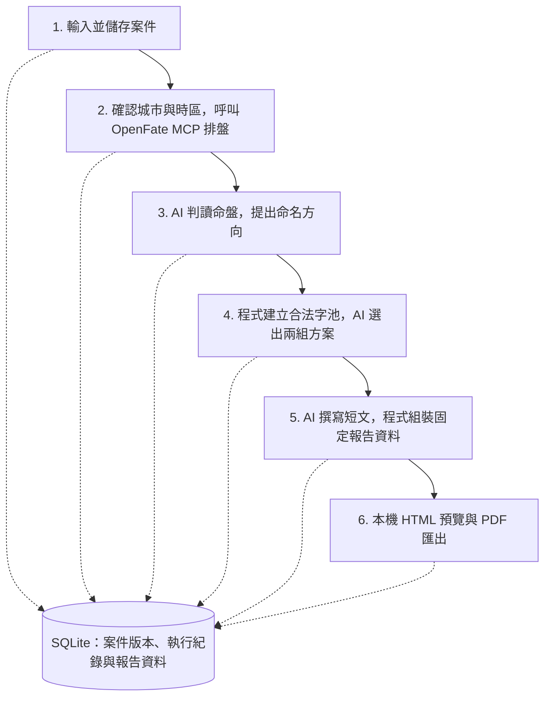

# OnlyFate

**讓沒有命理專業的商家，也能製作客製化的新生兒取名報告。**

OnlyFate 是 Windows 本機應用程式，將案件輸入、八字排盤、AI 判讀、姓名配置與報告製作串成可追溯的流程。商家輸入寶寶的出生資料、姓氏與家長偏好，系統整理成兩組取名方案，提供逐字說明、可交叉搭配的用字，以及 HTML 預覽與 PDF。

專案的商業目標是降低服務門檻與製作成本，最終讓商家能直接交付家長看得懂的正式報告。產品設計不以命理老師操作或逐案審稿為前提，也不要求家長理解開發用的檢查紀錄。

> **目前為研究試行版。** Step 1–6 的程式流程已接通，另有獨立離線示範；命理取用方法、字五行分類與真實 OpenAI 模型品質仍待驗證。目前的示範報告不能代表已達正式商用的命理品質。

## 成品會是什麼？

- **兩組不同的取名方案**：每組一個主推姓名、四個其他搭配示例，並說明選字方向與推薦理由。
- **可以自行搭配的完整字池**：每組名字第一字與第二字各有 4–5 個選項，逐字提供讀音、本義、命名祝願、風格與留意事項。
- **同組交叉比較**：組內所有第一字、第二字配對都經程式檢查；家長可以自行搭配，不只從五個示例中挑選。跨組組合不在這份驗證範圍內。
- **兩種閱讀形式**：HTML 適合螢幕瀏覽；PDF 依頁面任務編排，將選字與字義放在同頁比較。

現有林姓虛構案例可直接查看：

| 產物 | 內容 |
| --- | --- |
| [PDF 樣張 v11](output/pdf/onlyfate-naming-report-v11.pdf) | 已確認的六頁版：閱讀導覽、八字分析、兩組方案說明與兩頁配字比較 |
| [HTML 預覽 v12](output/pdf/onlyfate-naming-report-v12.html) | 與 PDF 共用內容、標題層級及主推標示；下載後以瀏覽器開啟，或在程式中預覽 |

GitHub 的 HTML 檔案頁顯示原始碼，不是線上應用程式。其他歷史樣張見 [產物入口](output/README.md)；目前的呈現約定見 [報告編排](docs/report-print-layout.md)。

## 完整處理流程

正常流程由商家在桌面介面逐步啟動。程式掌握步驟順序、資料讀寫與停止條件；模型只處理該階段交付的任務。

每個階段都有前置條件與結果檢查；資料不足、來源失效或檢查不通過時停止，不會直接往下產生報告。

### Step 1：輸入與儲存案件

商家透過制式欄位填入姓氏、性別、國曆出生日期、當地出生時間與出生地。避諱字、指定字／輩分字、詳細地點與家長需求為選填。避諱區只需填希望避開的字，不要求提供父母或長輩的完整姓名。

程式驗證必填與條件式欄位，使用 .NET 曆法換算農曆及閏月，再將原始表單存入 SQLite。修改後儲存會新增案件版本，保留前版。缺少必要出生資料時提示補齊，不自行猜測。

**此步不呼叫 AI。** 備註逐字保存，不先摘要，也不另開 AI 問答確認需求；後續判讀或選名才判斷哪些敘述可採用，並留下採用或略過的原因。

輸出是可追溯的案件版本、曆法結果、明確限制及備註原文。完整欄位與約定見 [Step 1](docs/step-1.md)。

### Step 2：出生地、時區與工具排盤

程式先從本機 GeoNames 資料找出城市候選，由商家確認城市及代表點精度。接著使用 NodaTime 依出生當年的時區規則解析標準時差、夏令時間與 UTC；遇到夏令時間跳時空檔或重複時刻，會停止並要求核對。

C# MCP client 啟動本機 OpenFate Node.js 程序，先取得排盤政策，再傳入出生日期時間、性別、經度、時區與排盤設定，取得四柱、藏干等命盤資料。程式檢查必要欄位、時間與政策是否一致，保存原始呼叫及通過檢查的結果。

**呼叫 MCP 不等於呼叫模型。** 本步由 C# 決定工具與參數，不經 OpenAI，也不讓模型計算出生時間或選擇排盤工具。OpenFate 在此負責排盤，不被視為已涵蓋姓名分析、選字或報告生成。

輸出是命盤、出生時間解析收據、工具呼叫及驗證紀錄。城市座標不是醫院精確座標；參數與定位限制見 [Step 2](docs/step-2.md)。

### Step 3：第一次 AI 呼叫——命理判讀

程式從 SQLite 讀取同一案件版本的有效命盤，將案件條件、命盤事實、固定試行規則及備註原文組成 context，送往 OpenAI Responses API。

模型的任務是提出盤面摘要、命名五行方向、引用依據、備註取捨與阻擋議題。候選方法以旺衰扶抑為主，另檢查調候適用性；這是本專案的試行規則，不是 OpenFate 已完成的喜用神決策。

回傳後，程式檢查結構、規則 ID、命盤引用值、備註原文及方向與阻擋狀態是否一致。模型不能改寫案件或工具事實。若有實際方法分歧或依據不足，流程停止，不靠反覆詢問模型取得想要的答案。

輸出是可供後續使用的試行判讀資料。通過程式檢查不代表命理判斷已獲證實；目前只允許符合條件的結果繼續試行。詳細契約見 [Step 3](docs/step-3.md)。

### Step 4：先計算合法字池，再請 AI 選出兩組

程式依命名方向、案件限制與有限字庫，計算筆畫、五格、三才、避諱字與已知國語讀音等條件，建立合法姓名及完整字池。每組兩個位置各 4–5 字，所有交叉配對都必須通過檢查；不只檢查主推姓名。

只有找到足夠的合法字池，才進行第二次模型呼叫。AI 從既有字池中選出兩組，各提供一個主推、四個其他示例與不同的風格說明；只能引用程式提供的 ID，不能自行新增候選字或姓名。

程式再核對字池、完整配對、候選 ID、示例重複與兩組差異。如果有限字庫無法同時滿足家長限制與自由配字需求，就停止，不私自放寬避諱或指定字條件。

輸出是兩組通過明確規則檢查的字池、主推、其他示例與選名理由。配字規格見 [Step 4–6](docs/step-4-6.md)，字庫來源及涵蓋範圍見 [有限字庫](resources/naming/README.md)。

### Step 5：撰寫家長看得懂的短文

第三次模型呼叫只提供已選示例、字義資料、選名理由與已採用的偏好，讓 AI 撰寫簡短祝願及特色說明，不重新排盤或選名字。

程式檢查組別與候選 ID 是否完整、文字長度及明確內容限制。讀音、本義、逐字說明、姓名、生日、筆畫與命盤由固定資料組裝；命名方向與依據沿用同一份 Step 3 結果，不讓撰稿階段事後編造理由。

輸出是固定的報告資料，包含來源版本、兩組方案、完整字池、全部合法搭配及短文。保存時一併記錄內容雜湊，作為後續產物核對依據。

### Step 6：產出 HTML 預覽與 PDF

同一份報告資料先生成 HTML，再由 WebView2 預覽及列印成 PDF。**此步不呼叫 AI。** 螢幕版可隨視窗調整欄數並提供段落導覽；PDF 依頁面安排閱讀順序，讓家長在挑字頁就能交叉比較字義與搭配。

HTML 與 PDF 分別保存產出狀態，不把預覽成功當成 PDF 已完成。舊報告與產物保留；若檔案遺失或損壞，可由仍有效的固定資料建立新副本，不必重新付費呼叫模型。來源版本已失效時，不能用重建檔案繞過檢查。

輸出是本機可預覽、另存的報告。詳細資料契約見 [Step 4–6](docs/step-4-6.md)，螢幕與印刷分工見 [報告編排](docs/report-print-layout.md)。

## AI 與 Agent Harness 如何分工？

目前採用 **C# 控制固定流程，模型處理三個有明確輸入與輸出的任務**。正常完成一個案件會呼叫模型三次：判讀、選名、短文撰寫。

| 模型呼叫 | 主要 context | 預期模型輸出 |
| --- | --- | --- |
| Step 3：判讀 | 案件條件、已核對命盤、試行規則、備註原文 | 摘要、引用依據、命名方向、備註取捨、阻擋議題 |
| Step 4：選名 | 明確限制、Step 3 的選字五行、合法字池與候選、逐字資料、備註原文 | 兩組字池 ID、各組主推及四個示例、風格與理由 |
| Step 5：短文 | 兩組已選示例、字義、選名理由、已採用偏好 | 對應示例的簡短祝願、特色與摘要 |

每一步都準備獨立的 API request，只傳必要的前步結果。使用同一個模型不代表模型自動記得上一步；應用程式不傳整段開發聊天，也不靠長期對話保存流程狀態。

請求由四個部分構成：`model` 指定模型、`instructions` 定義任務與規則、`input` 放本次資料、`text.format` 定義嚴格 JSON Schema。`context` 是本專案放在輸入資料中的結構，不是 OpenAI 自動管理的記憶。實際請求可先在介面預覽，再決定執行。

目前由自訂的 [OpenAiResponsesClient](src/OnlyFate.Database/OpenAiResponsesClient.cs) 使用 `HttpClient` 呼叫 `POST https://api.openai.com/v1/responses`，未採用 OpenAI SDK 或 Agents SDK，也沒有提供讓模型自行選用的 `tools`。模型不直接讀寫 SQLite 或呼叫 MCP。

本專案所說的 **harness** 是 C# 的執行控制：準備 context、保存 request、呼叫 API、讀取回應、程式驗證、有限修正、停止及寫回。共用入口是 [ModelCallRunner](src/OnlyFate.Database/ModelCallRunner.cs)，各階段透過自己的契約限定模型責任。

### 一次呼叫如何採用或停止？

1. 確認案件與上游結果有效，固定本次輸入版本。
2. 保存呼叫開始紀錄，送出實際 request。
3. 確認 HTTP 與 API 完成狀態，處理拒答或截斷，再解析模型 JSON。
4. 由 C# 檢查格式、事實引用、候選及業務限制。
5. 格式或引用等可修正錯誤，最多再呼叫一次，附上原本事實、前次輸出與錯誤清單。
6. 通過後，在交易內重新確認來源版本，再保存可供下一步使用的結果。

每階段的首次呼叫與修正共用 120 秒期限。網路／HTTP 失敗、拒答、截斷、取消及逾時不自動重送；命理分歧也不靠重試消除。正常流程三次模型呼叫，三階段各修正一次時最多六次；手動重做另留一筆執行紀錄。

完整 context 白名單、保存欄位與各階段契約，以 [AI 呼叫流程](docs/ai-call-flow.md) 及其連結文件為準。JSON 合法、引用一致與命理方法正確，是不同層次的驗證。

## 資料保存與追溯

案件、案件版本、工具／模型呼叫、驗證結果及報告資料保存在本機 SQLite；HTML、PDF 與 WebView2 資料也保存在本機。正常案件與離線示範使用不同資料目錄。

- **案件版本**：修改輸入會追加版本，不覆寫原始歷史。
- **執行紀錄**：保留工具參數、模型 request／response、狀態、耗時及有回傳的 token usage。
- **來源一致性**：案件改版或上游重做後，舊下游結果不再當成有效結果使用，但仍保留紀錄。
- **交易邊界**：等待 MCP 或 OpenAI 時不持有 SQLite 交易；寫回前再核對來源。
- **重新開啟**：載入已保存結果，不自動重新呼叫工具或付費模型。

本機保存不代表全程離線：OpenAI 呼叫會送出該步的 context，備註也可能包含使用者自行輸入的個資。API key 僅用於請求認證，不寫入 SQLite、context 或報告；`store=false` 也不等於服務端完全零資料保留。

資料表與交易設計見 [DB Schema](docs/database-schema.md)；實際欄位以 [SQL migrations](database/migrations/001_Initial.sql) 為準。

## 技術組成

| 技術 | 本專案的用途 |
| --- | --- |
| C#／.NET 10、WPF | Windows 桌面介面與流程控制 |
| SQLite | 本機案件、版本、執行紀錄及報告資料 |
| WebView2、HTML／CSS | 本機報告預覽與 PDF 列印 |
| OpenFate MCP、Node.js | 本機八字計算工具 |
| GeoNames、NodaTime | 出生城市候選及歷史時區解析 |
| OpenAI Responses API | 三階段結構化模型輸出 |

第一版不需要架設網站或雲端資料庫。相依套件使用各自的 lock file，開發與維運以本機需求為主；目前沒有加入微服務、RAG 或向量搜尋。

## 開始執行與驗證

開發需要 Windows、.NET 10 SDK、Node.js 20 以上及 npm；桌面執行需要 .NET 10 Windows Desktop Runtime 與 WebView2 Runtime。SDK 選版以 [global.json](global.json) 為準。

1. 依 [桌面程式 README](src/OnlyFate.Desktop/README.md#建置與執行) 還原 OpenFate 及 NuGet 套件，再建置、測試與 publish。
2. 開啟產生的 `output/app/OnlyFate.Desktop.exe`。發行資料夾不納入 Git，目前沒有安裝包，也未附帶 Node.js 執行檔。
3. 先使用離線示範確認介面與報告；可加 `--demo` 啟動。示範使用固定虛構資料，不呼叫真實 OpenAI，也不代表模型品質驗證。
4. 實際執行 AI 階段時，在介面提供模型 ID 與 API key，或使用 `OPENAI_MODEL`／`OPENAI_API_KEY` 環境變數。目前沒有預設模型。

測試入口及範圍見 [tests README](tests/README.md)。核心測試使用隔離資料庫；WPF 測試不顯示視窗、不操作滑鼠鍵盤。模型測試使用假 transport；OpenFate 則有真正的本機 MCP 計算測試。視覺及完整操作驗收見 [驗收紀錄](docs/acceptance.md)。

**仍待完成的驗證**：正式命理規則與反例、字庫涵蓋與分類品質、真實 OpenAI 的結果品質／成本／延遲，以及正式散佈所需的套件授權通知。現階段支援範圍以單字姓、兩字名及有限國語字庫為主，不宣稱支援所有姓氏、方言或家族限制。

## 專案目錄與閱讀入口

| 位置 | 責任 |
| --- | --- |
| [src/OnlyFate.Desktop](src/OnlyFate.Desktop/README.md) | WPF 表單、操作流程、WebView2 預覽與匯出 |
| [src/OnlyFate.Database](src/OnlyFate.Database/README.md) | SQLite 存取、驗證、MCP／AI 契約、命名及報告核心 |
| [database/](database/README.md) | SQL migrations、欄位定義與邏輯參照查核 |
| [tests/](tests/README.md) | 隔離的資料、流程與桌面控制項測試 |
| [tools/openfate/](tools/openfate/README.md) | 本機 MCP runtime 的套件版本及還原方式 |
| [resources/](resources/README.md) | 地理資料、有限字庫及來源說明 |
| [docs/](docs/map.md) | 產品規格、實作契約、決策與驗收紀錄 |
| [output/](output/README.md) | 已提交的示範報告與歷史樣張；本機發行程式另行產生 |
| 根目錄 `lin-baby-*`、`calendar-conversion-*` | 虛構案例研究與計算證據，入口見 [研究資料](docs/research/README.md) |
| `tmp/` | 可重建暫存與測試產物，不納入 Git |

README 提供專案與流程導覽；詳細規格依 [文件路由](docs/map.md) 閱讀，Agent 協作規則見 [AGENTS.md](AGENTS.md)。第三方套件及資料的來源與授權分別見 [OpenFate runtime](tools/openfate/README.md#來源及授權)、[GeoNames](resources/geography/README.md) 與 [字庫來源](resources/naming/sources-v2.md)。
