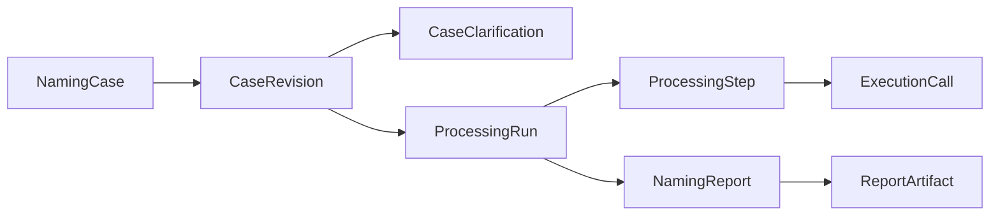

# SQLite Schema v1

日期：2026-11-03。此頁保存第一版單機案件資料與六步處理紀錄的 schema 設計。後續已在不改 schema 的情況下接通 Step 1–6；案件存取見 [Step 1](step-1.md)，模型與報告寫入見 [Step 3](step-3.md)、[Step 4–6](step-4-6.md)。

## SQLite 與既有習慣的取捨

已透過 Obsidian CLI 重新核對 meteorVault 的〈AI Agent 協作/我的DB 設計習慣〉，沿用 PascalCase、`{TableName}ID`、`for{Entity}ID`、不建 physical FK、非 PK 允許 NULL、`IX_`／partial `UX_`，以及 State 與 Status 分工。

SQLite **不支援 stored procedure**，因此不建立 `sp*`／`fn*` routine。後續業務處理用 C#、參數化 SQL 與明確的 ADO.NET transaction；不以 trigger 模擬整個流程，也不以自訂 SQL function 冒充 SP。[Microsoft 官方限制說明](https://learn.microsoft.com/en-us/dotnet/standard/data/sqlite/adonet-limitations)、[交易說明](https://learn.microsoft.com/en-us/dotnet/standard/data/sqlite/transactions)。

另一個平台差異是 Microsoft.Data.Sqlite 的 async ADO.NET 方法實際同步執行。本輪命令列工具直接用同步 API；未來接 WPF 時需另處理 UI 執行緒與工作取消，不能把加上 `Async` 當成不阻塞的保證。[官方說明](https://learn.microsoft.com/en-us/dotnet/standard/data/sqlite/async)。

## 表與責任

| 資料表 | 唯一責任 | 邏輯父資料 |
| --- | --- | --- |
| NamingCase | 案件識別、標題、啟停與列表時間 | 無 |
| CaseRevision | 一版原始表單、整理結果、限制、農曆換算與資料就緒狀態 | NamingCase |
| CaseClarification | 針對輸入版本的補問、原文依據與答覆 | CaseRevision |
| ProcessingRun | 綁定輸入版本的一次流程與實際規則版本 | CaseRevision |
| ProcessingStep | 六步中某階段的一次嘗試，含輸入、結果及檢查依據 | ProcessingRun |
| ExecutionCall | 某階段的一次模型或工具呼叫證據與 usage | ProcessingStep |
| NamingReport | 同一份可供 PAGE／PDF 渲染的固定報告資料與版本 | ProcessingRun |
| ReportArtifact | 某版報告的本機 HTML／PDF 產物位置及檔案 hash | NamingReport |
| SchemaMigration | 已套用的 SQL 版本、腳本 hash 與時間 | 無，技術用途 |

箭頭表示邏輯關聯，不是 physical FK。帳號、租戶、訂閱、金流、共用字庫、向量索引與家族成員資料表不在本版範圍。

## 欄位、型別與索引的權威來源

完整欄位、default、值域、CHECK、索引及用途註解以 [001_Initial.sql](../database/migrations/001_Initial.sql) 為準，本頁不維護第二份欄位清單。

- 採 STRICT tables，PK 使用 `INTEGER PRIMARY KEY`；不使用 AUTOINCREMENT 關鍵字。其他欄位允許 NULL，未知資料不以空字串、零筆 usage 或假出生時間取代。
- `State` 僅用於 NamingCase 啟停，`0=正常／啟用`、`1=停用`。其他表依其責任使用 `Status`；不為不可刪改的執行證據另加啟停欄位。
- 系統時間用 UTC TEXT，格式 `yyyy-MM-ddTHH:mm:ss.fffZ`。`BirthDate` 是原始國曆 `YYYY-MM-DD`；`BirthTimeLocal` 是出生地 `HH:mm`，不補秒數；`BirthTimeZoneID` 與地理解析資料另存。
- 農曆、閏月及來源放 `CalendarDataJson`，以原始民用日期為基準；真太陽時、命盤及工具輸出放相應的 ProcessingStep／ExecutionCall，不改寫原始生日。
- `AvoidanceStatus` 與 `RequiredCharacterStatus` 區分未提供、明確沒有與有指定。避諱字模式及指定字位置按 Step 1 約定保存，不增加父母／長輩完整姓名欄位。
- 核心查詢關係、版本、狀態、出生事實用欄位；彈性 context、工具輸出、來源與報告資料用 JSON TEXT。JSON 只檢查合法格式與 object／array 型態，不聲稱內容正確或命理方法已驗證。
- 唯一索引皆採 `UX_` partial indexes，針對已提供關聯／版本的資料檢查重複；不以停用為理由讓歷史版本號重複。一般索引只對案件列表、補問查詢與案件執行歷程建立。

## 資料寫入契約

以下是 C# 寫入服務的契約。CaseRepository 已實作案件與輸入版本的交易寫入；[Step 2](step-2.md) 已實作排盤 run／step／工具呼叫紀錄，其他階段及報告寫入仍待後續。這些契約不是由 DB trigger 自動鎖住歷史資料。

1. 一個案件可有多個 CaseRevision。修正出生資料、限制或納入補問答覆後，建立新版本；已被 run 使用的版本不原地覆寫。補問與答覆原文另外保留。
2. 一次 ProcessingRun 固定指向一個輸入版本；每個 ProcessingStep 用 StepNumber 與 AttemptNumber 保留各次嘗試。不是每步都要有模型呼叫；不需要模型時不建立假的 usage 紀錄。
3. ExecutionCall 的 `CallKind` 明確分開 model／tool。RequestJson 保存必要的 request body／context，不能寫入 Authorization header、API key、連線密碼或模型內部思考逐字稿。第三方原始回傳與模型解讀不能互相冒充。
4. 已就緒的 NamingReport 固定 ReportDataJson、TemplateVersion 與資料 hash。PAGE／PDF 的 ReportArtifact 指向同一報告。`html` 表示本機預覽產物，不等同公開分享網址或對外 HTML 匯出功能。
5. 同報告每格式只保留一個交付紀錄；內容或版型修改時建立新報告版本，不覆蓋已完成版本。產物路徑相對於報告根目錄，寫入服務須阻止路徑逃逸並驗證實際檔案 hash。
6. 沒有 physical FK；參照存在性、父子狀態與跨資料表寫入必須在應用程式交易內驗證。停止案件不自動刪除歷史；本輪不提供硬刪除或級聯刪除功能。

CHECK 只阻止明顯不完整的 `ready` 狀態與格式錯誤。例如缺出生時間不能把 CaseRevision 設成 ready；沒有報告資料／檢查結果不能將 NamingReport 設成 ready。完整的時間／地點解析、JSON 內部語意、規則與內容檢查仍由程式負責。

## 建置、版本與驗證

- 本輪採 Microsoft.Data.Sqlite，未引入 ORM。版本由 [工具 csproj](../src/OnlyFate.Database/OnlyFate.Database.csproj) 與其 packages.lock.json 鎖定。
- 實際 DB 為 `%LOCALAPPDATA%\OnlyFate\Data\OnlyFate.db`；不寫在程式安裝目錄或 Git 倉庫。未提供正式案件資料或範例訂單；只有 SchemaMigration 的技術紀錄。
- 初始化只處理空白 DB 或符合 v1 的既有 DB。DDL、版本、application_id 與 migration 紀錄在同一個交易提交；重複執行保留資料。不識別的既有 DB、較新版本或腳本 hash 不符時拒絕操作，不覆寫、不降版。
- 已套用的 migration 不改寫。未來 schema 變更需要新腳本、相應升級邏輯與資料測試；本輪沒有預先建立通用 migration framework。
- `verify` 唯讀檢查版本、migration hash、資料表清單、SQLite integrity，以及 [邏輯參照查核](../database/checks/logical-references.sql)。它不修復孤兒資料，也不代表完整業務／報告／產物檔案驗證。
- 18 項非 GUI 測試通過，涵蓋重複初始化、NULL 草稿、日期時間、JSON 型態、版本唯一性、交易回滾、陌生 DB 保護、checksum 與版本拒絕、邏輯孤兒，以及輸入版本→執行→報告→兩種格式的關聯。
- 已對實際本機 DB 執行 init 與 verify；schema v1 共 9 表，SQLite integrity 通過，沒有非 NULL 孤兒參照。未操作桌面視窗，也沒有呼叫 OpenAI API 或 OpenFate。
- 一般全方案建置曾因正在執行的桌面程式鎖住原輸出檔而失敗（MSB3027／MSB3021）；未關閉該程式，改以 `dotnet build OnlyFate.slnx --artifacts-path tmp/build-check --verbosity minimal` 隔離輸出後，三個專案建置通過且零警告、零錯誤。資料庫工具本身的一般建置亦通過。

操作命令以 [database README](../database/README.md) 為準；測試入口見 [tests README](../tests/README.md)。上列 18 項與初始建庫為 schema 建置當時的驗證；後續案件表單及排盤已接入 DB，新增的資料快照與驗證邊界見 [Step 1](step-1.md)／[Step 2](step-2.md)。

SQLite 能力依據：[STRICT tables](https://www.sqlite.org/stricttables.html)、[JSON](https://www.sqlite.org/json1.html)、[partial indexes](https://www.sqlite.org/partialindex.html)、[transaction](https://www.sqlite.org/lang_transaction.html)。
